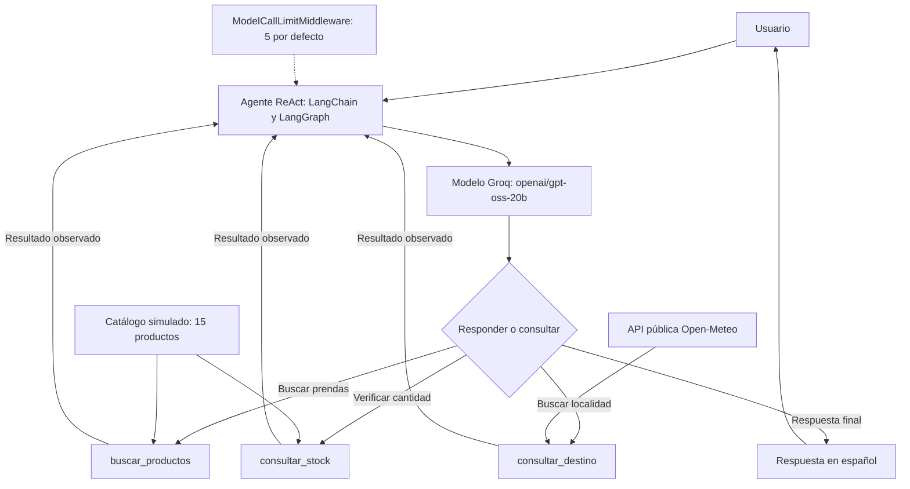

# Agente inteligente de ventas e inventario para una tienda de ropa

**Módulo 3 – Diseño y Orquestación de Agentes Inteligentes**  
**Integrante:** Carolina Andrea Villalobos Montaño  
**Repositorio:** [upi-m3-agente-ventas-inventario](https://github.com/carito1597/upi-m3-agente-ventas-inventario)

## 1. Problema, usuarios y alcance

Vendedores y propietarios de pequeñas tiendas de ropa necesitan consultar productos, precios y existencias con rapidez para atender a sus clientes. Este prototipo permite hacer esas consultas en lenguaje natural y buscar localidades bolivianas mediante una API pública.

El catálogo contiene **15 prendas exclusivamente simuladas**, con identificadores `ROP001` a `ROP015`, precios en bolivianos (Bs) y stock entero no negativo. Incluye productos agotados (`ROP005`, `ROP009` y `ROP013`). No representa el inventario de una tienda real.

El agente solo consulta información: no registra compras, procesa pagos, reserva productos, modifica inventario, notifica reposiciones ni gestiona envíos. Encontrar una localidad no confirma cobertura de envío.

## 2. Arquitectura ReAct y justificación

Se utiliza `create_agent` de LangChain, sobre LangGraph, con el modelo `openai/gpt-oss-20b` servido por Groq. El agente interpreta la consulta, elige una herramienta, observa su resultado y decide si necesita otra consulta o si puede responder.

ReAct resulta adecuado porque las preguntas requieren recorridos diferentes: buscar una prenda, comprobar una cantidad o consultar una ciudad. Una verificación de disponibilidad puede necesitar primero identificar el producto y después consultar su stock. Un workflow sería útil para una secuencia fija; aquí exigiría definir ramas explícitas para cada recorrido. La flexibilidad de ReAct implica que la selección de herramientas y las respuestas requieren evaluación y límites de ejecución.



Las flechas de retorno representan el ciclo de consulta. El diagrama describe la orquestación, sin exponer razonamiento interno del modelo.

## 3. Las cinco primitivas

| Primitiva | Implementación actual | Evidencia |
|---|---|---|
| Instrucciones | System prompt: español breve, herramientas antes de informar datos, precios en Bs, aclaraciones y prohibición de prometer operaciones no disponibles. | [agente.py](agente.py), variable `instrucciones`. |
| Herramientas | Búsqueda de prendas, consulta de disponibilidad y geocodificación de ciudades. | [herramientas.py](herramientas.py), tres funciones con `@tool`. |
| Memoria | Historial de mensajes y resultados durante una invocación. No hay memoria persistente entre ejecuciones. | Mensajes enviados a `agente.invoke()` y devueltos por el agente. |
| Estado | Mensajes del usuario, `AIMessage` con llamadas y argumentos, y `ToolMessage` con resultados. | [pruebas.py](pruebas.py), función `registrar_llamadas`. |
| Control | `ModelCallLimitMiddleware` con límite por ejecución y `recursion_limit=15` para los pasos del grafo. | [agente.py](agente.py) y [evidencia_control.txt](evidencia_control.txt). |

## 4. Contratos de herramientas

Todas las herramientas son de lectura. Las respuestas normales son diccionarios; los errores de validación de argumentos del decorador pueden devolver directamente el texto `ERROR: Argumentos inválidos para la herramienta`.

| Nombre y propósito | Parámetros | Resultado normal | Manejo de errores |
|---|---|---|---|
| `buscar_productos`: filtra el catálogo. | `nombre: str = ""`, `talla: str = ""`, `color: str = ""`. Los filtros vacíos no restringen la búsqueda. | `productos`: lista de prendas con `id`, `nombre`, `categoria`, `talla`, `color`, `precio` y `stock`; `mensaje`: coincidencias encontradas o sin coincidencias. | Filtros inválidos: lista vacía y `mensaje` con `ERROR:`. Una búsqueda sin coincidencias no es un error. |
| `consultar_stock`: compara la cantidad solicitada con las existencias sin modificarlas. | `producto_id: str` obligatorio; `cantidad: int = 1`. Se normalizan espacios externos y mayúsculas del ID. | `producto`, `stock`, `cantidad_solicitada`, `disponible` booleano. | Cantidad no positiva, ID vacío o inexistente: `disponible: false` y `mensaje` con `ERROR:`. Stock cero o insuficiente es un resultado normal. |
| `consultar_destino`: busca localidades bolivianas. | `ciudad: str` obligatorio, al menos dos caracteres tras quitar espacios externos. | `encontrado`, `ubicaciones` con `ciudad` y `departamento`, y `fuente: "Open-Meteo"`. Si falta el departamento se usa `No indicado`. | Ciudad inválida, timeout, error HTTP, conexión, JSON inválido o estructura inesperada: `encontrado: false` y `mensaje` con `ERROR:`. Sin coincidencias devuelve una lista vacía, sin error. |

La búsqueda normaliza mayúsculas, tildes y espacios, y reconoce variantes sencillas de singular/plural y algunos colores en femenino. Es una normalización heurística, no un analizador lingüístico completo. Los datos originales del catálogo no se alteran.

## 5. API pública y errores

`consultar_destino` realiza una petición real a `https://geocoding-api.open-meteo.com/v1/search`, con `name` igual a la ciudad, `count=5`, `language=es`, `countryCode=BO` y `timeout=10` segundos. No envía la clave de Groq a esta API.

La herramienta comprueba el estado HTTP y valida que el JSON sea un objeto, que `results` sea una lista cuando esté presente y que las localidades tengan nombres válidos. También valida `admin1` cuando aparece. La ausencia de `results` se interpreta como una lista vacía.

Ejemplos del contrato, no ejecuciones adicionales:

```json
{"disponible": false, "mensaje": "ERROR: Producto inexistente"}
```

```json
{"encontrado": false, "mensaje": "ERROR: Open-Meteo devolvió un error HTTP"}
```

El prefijo `ERROR:` distingue entradas inválidas y fallos técnicos de respuestas normales como producto agotado o búsqueda vacía. El agente tiene instrucciones para explicar esos errores sin inventar datos. Open-Meteo proporciona coincidencias geográficas; no proporciona cobertura comercial, tarifas ni tiempos de entrega.

## 6. Instalación y ejecución en Windows

Requisitos: Windows con PowerShell, Git, Python 3.12, conexión a internet y una clave válida de Groq. Las consultas reales dependen de la disponibilidad y límites del proveedor.

```powershell
git clone https://github.com/carito1597/upi-m3-agente-ventas-inventario.git
cd upi-m3-agente-ventas-inventario
py -3.12 --version
py -3.12 -m venv .venv
.\.venv\Scripts\python.exe -m pip install -r requirements.txt
Copy-Item .env.example .env
notepad .env
```

En una instalación nueva, sustituir localmente el marcador de `GROQ_API_KEY` por la clave propia y guardar `.env`. Si el archivo ya existe, conservarlo en lugar de copiarlo de nuevo. `.env` está excluido mediante `.gitignore`; no debe publicarse ni mostrarse en el video.

Se utiliza directamente el Python del entorno virtual, sin necesidad de activar scripts de PowerShell. `-X utf8` fuerza UTF-8 para la salida de Python.

```powershell
# Consulta predeterminada
.\.venv\Scripts\python.exe -B -X utf8 agente.py

# Consulta personalizada: pasar el texto entre comillas
.\.venv\Scripts\python.exe -B -X utf8 agente.py "Busca un vestido rojo talla M y verifica si hay 2 unidades disponibles."

# Evaluación real: muestra el detalle y la tabla en terminal
.\.venv\Scripts\python.exe -B -X utf8 pruebas.py
```

`agente.py` muestra `CONSULTA` y `RESPUESTA`. `pruebas.py` guarda automáticamente el informe en UTF-8, reemplazando [resultados_pruebas.txt](resultados_pruebas.txt). Cada ejecución de pruebas usa el agente real y puede consumir cuota de Groq. Importar `pruebas.py` no ejecuta las consultas.

## 7. Control de ejecución y reproducción

La configuración actual es:

```python
ModelCallLimitMiddleware(
    run_limit=int(os.getenv("MODEL_RUN_LIMIT", "5")),
    exit_behavior="end"
)
```

El límite predeterminado es **5 llamadas al modelo por invocación**, configurable con `MODEL_RUN_LIMIT`. No es un límite de cinco herramientas ni un presupuesto total de tiempo; los reintentos del cliente son otra configuración. `recursion_limit=15` limita los pasos del grafo y tampoco equivale al número de llamadas al modelo.

Reproducción desde la carpeta del proyecto, conservando el valor previo de la variable:

```powershell
$consulta = "Busca un vestido rojo talla M y verifica si hay 2 unidades disponibles."
$limiteAnterior = $env:MODEL_RUN_LIMIT
try {
    $env:MODEL_RUN_LIMIT = "1"
    .\.venv\Scripts\python.exe -B -X utf8 agente.py $consulta

    $env:MODEL_RUN_LIMIT = "5"
    .\.venv\Scripts\python.exe -B -X utf8 agente.py $consulta
} finally {
    if ($null -eq $limiteAnterior) {
        Remove-Item Env:MODEL_RUN_LIMIT -ErrorAction SilentlyContinue
    } else {
        $env:MODEL_RUN_LIMIT = $limiteAnterior
    }
}
```

La evidencia real conservada en [evidencia_control.txt](evidencia_control.txt) muestra:

| Configuración | Llamadas a herramientas observadas | Salida real |
|---|---|---|
| `MODEL_RUN_LIMIT=1` | `buscar_productos`. | `Model call limits exceeded: run limit (1/1)`; el middleware impidió continuar con otra llamada al modelo. |
| `MODEL_RUN_LIMIT=5` | `buscar_productos` y `consultar_stock`. | Confirmó 3 unidades del vestido rojo M y disponibilidad para 2. |

Con `exit_behavior="end"`, el límite finaliza con un mensaje y ambas ejecuciones registradas devolvieron código de salida 0. El campo exploratorio `LLAMADAS AL MODELO: None` del archivo indica que el contador no estaba expuesto en el resultado, no que hubo cero llamadas. La detención se acredita con el mensaje real del middleware y las herramientas registradas.

Los comandos anteriores muestran las nuevas salidas en terminal; no regeneran automáticamente `evidencia_control.txt`. Ese archivo conserva la demostración realizada.

## 8. Evaluación automática de diez casos

Cada caso de [pruebas.py](pruebas.py) define una consulta, `debe_usar` (herramientas obligatorias), `no_debe_usar` (herramientas prohibidas) y `esperado` (condición verificable sobre argumentos y resultados).

Las consultas se ejecutan mediante `agente.invoke()`. Las llamadas de `AIMessage` se relacionan con sus `ToolMessage` mediante el identificador de llamada; se registran argumentos, resultados reales y respuesta final. Se evalúan por separado:

1. **Selección:** aparecen todas las herramientas obligatorias y ninguna prohibida. Otras herramientas no prohibidas pueden utilizarse.
2. **Resultado esperado:** al menos una llamada de la herramienta pertinente cumple la condición definida. Según el caso se contrastan argumentos, datos completos del producto con el catálogo, existencias, disponibilidad, errores esperados o localidades. También se comprueba que exista una respuesta final no vacía del agente.
3. **General:** requiere selección y resultado esperado correctos. Una herramienta correcta por sí sola no basta.

Los estados son `OK`, `FALLO` y `NO VERIFICABLE`. La falta de una herramienta obligatoria o un resultado contrario al esperado produce un fallo. Una excepción de ejecución, un resultado no interpretable o un error técnico que impide comprobar la condición se informa como no verificable, con su motivo, y se continúa con los demás casos. En los casos de ID inexistente y cantidad cero, el error de entrada es precisamente el resultado esperado.

### Resultados registrados

Fuente exclusiva: [resultados_pruebas.txt](resultados_pruebas.txt), ejecución identificada como `2026-11-14T10:06:02.148097+00:00`. La siguiente tabla resume sus diez casos, no nuevas ejecuciones:

| Caso | Consulta resumida y condición comprobada | Selección | Resultado esperado | General |
|---|---|---|---|---|
| 1 | Blusa negra M: `ROP001` con sus datos del catálogo. | OK | OK | OK |
| 2 | Vestido rojo M: `ROP004`, cantidad 2, stock 3 y disponible. | OK | OK | OK |
| 3 | Cochabamba: coincidencia geográfica devuelta por la API. | OK | OK | OK |
| 4 | Chaqueta denim S: `ROP005`, stock 0. | OK | OK | OK |
| 5 | Zapatos deportivos M: búsqueda correspondiente sin productos. | OK | OK | OK |
| 6 | Camiseta básica blanca XS: `ROP006` con sus datos del catálogo. | OK | OK | OK |
| 7 | `ROP004`, cantidad 10: stock 3 y disponibilidad falsa. | OK | OK | OK |
| 8 | `ROP999`: disponibilidad falsa y error de producto inexistente. | OK | OK | OK |
| 9 | `ROP004`, cantidad 0: disponibilidad falsa y error de cantidad. | OK | OK | OK |
| 10 | `ZzxqvInventada987654`: sin localidad encontrada y lista vacía. | OK | OK | OK |

Para cada dimensión, `porcentaje = casos OK / total de casos ejecutados × 100`. El denominador incluye los diez casos; los no verificables no cuentan como aciertos.

| Dimensión | Cumplimiento registrado | Fallos | No verificables |
|---|---|---|---|
| Selección de herramientas | 10/10 = 100.0 % | 0 | 0 |
| Resultado esperado | 10/10 = 100.0 % | 0 | 0 |
| General | 10/10 = 100.0 % | 0 | 0 |

El programa devuelve código 0 si todos los casos son `OK`, y 1 en otro caso. Estos resultados corresponden a la ejecución guardada; no garantizan que futuras ejecuciones produzcan lo mismo.

**Alcance de la evaluación:** valida selección y resultados de herramientas, no la exactitud semántica integral del texto final. En el caso 3, la API devolvió varias localidades llamadas Cochabamba y el agente respondió sin pedir aclaración; el caso pasó porque su condición comprobaba la coincidencia geográfica. Esta limitación no queda cubierta por el 100 % registrado.

## 9. Archivos y evidencias

| Archivo | Función |
|---|---|
| [agente.py](agente.py) | Modelo, prompt, herramientas, middleware y entrada por terminal. |
| [catalogo.py](catalogo.py) | Quince productos simulados con precios en Bs y existencias. |
| [herramientas.py](herramientas.py) | Tres herramientas, normalización y manejo de errores. |
| [pruebas.py](pruebas.py) | Diez consultas reales y evaluación automática. |
| [resultados_pruebas.txt](resultados_pruebas.txt) | Registro UTF-8 de consultas, llamadas, argumentos, resultados, respuestas y porcentajes. |
| [evidencia_control.txt](evidencia_control.txt) | Demostración real con límites 1 y 5 y comandos de reproducción. |
| [requirements.txt](requirements.txt) | Dependencias con versiones fijadas. |
| [.env.example](.env.example) | Plantilla de configuración sin credenciales reales. |
| [.gitignore](.gitignore) | Exclusión de `.env`, entorno virtual y caché de Python. |

## 10. Limitaciones y posibles mejoras

- El inventario es una lista simulada en memoria; no se registran ventas ni se actualiza stock.
- No hay memoria persistente ni interfaz de conversación de varios turnos en la CLI. Una aclaración posterior requiere que una aplicación conserve y reenvíe el historial.
- La normalización de singular/plural y colores cubre variantes sencillas, no todos los sinónimos o formas del español.
- Las instrucciones orientan el comportamiento, pero no garantizan que el modelo siempre pida aclaraciones o evite respuestas inadecuadas. La evaluación del texto final sigue siendo limitada.
- Groq y Open-Meteo requieren conectividad; sus fallos, cuotas y cambios de servicio pueden afectar las ejecuciones. El control de llamadas no sustituye el manejo general de errores de la CLI.
- La geocodificación puede devolver varias localidades y no acredita servicios de envío.

Como mejoras futuras, se podría ampliar la evaluación de las respuestas finales y de las aclaraciones, añadir comprobaciones locales con HTTP simulado, reforzar la validación estricta de argumentos y presentar mejor los errores de configuración y conexión. Estas mejoras no se consideran implementadas en esta versión.

## 11. Video de demostración

**Duración requerida: 3 a 5 minutos. Enlace: pendiente de incorporar.**

La demostración deberá mostrar una consulta normal, una consulta real a Open-Meteo, un error de entrada, la detención con límite 1, el funcionamiento con límite 5 y la tabla de evaluación. No mostrar `.env` ni claves API.

## 12. Cumplimiento de la rúbrica

La tabla identifica evidencias disponibles y pendientes; no representa una aprobación ni una calificación otorgada.

| Criterio | Puntos | Evidencia exacta en el repositorio | Estado de la evidencia |
|---|---|---|---|
| Agente ejecutable con salidas visibles | 30 | [agente.py](agente.py), bloque `if __name__ == "__main__"`; [resultados_pruebas.txt](resultados_pruebas.txt), líneas `Respuesta final`; [evidencia_control.txt](evidencia_control.txt), sección `MODEL_RUN_LIMIT=5`. | Código y salidas reales disponibles. |
| README y cinco primitivas | 20 | Este README, secciones 2, 3, 4 y 6: arquitectura, diagrama, cinco primitivas, contratos y reproducción. | Documentación disponible. |
| Herramientas con API real y errores | 15 | [herramientas.py](herramientas.py), `consultar_destino` y sus excepciones; [resultados_pruebas.txt](resultados_pruebas.txt), casos 3 y 10 (API), 8 y 9 (errores de entrada). | Código y ejecuciones reales disponibles; no se afirma que el informe cubra todos los fallos técnicos. |
| Control funcionando | 15 | [agente.py](agente.py), `ModelCallLimitMiddleware`; [evidencia_control.txt](evidencia_control.txt), secciones `MODEL_RUN_LIMIT=1` y `MODEL_RUN_LIMIT=5`. | Detención y ejecución normal registradas. |
| Evaluación de cinco casos ejecutada | 10 | [pruebas.py](pruebas.py), lista `casos` y `main()`; [resultados_pruebas.txt](resultados_pruebas.txt), casos 1 a 10 y tabla resumen. | Diez casos registrados, superando el mínimo de cinco. |
| Video de 3 a 5 minutos | 10 | Sección 11 de este README: enlace pendiente. | Pendiente; no hay video referenciado como evidencia. |
| **Total de la rúbrica** | **100** | La asignación de puntos corresponde al docente. | Sin calificación declarada. |
