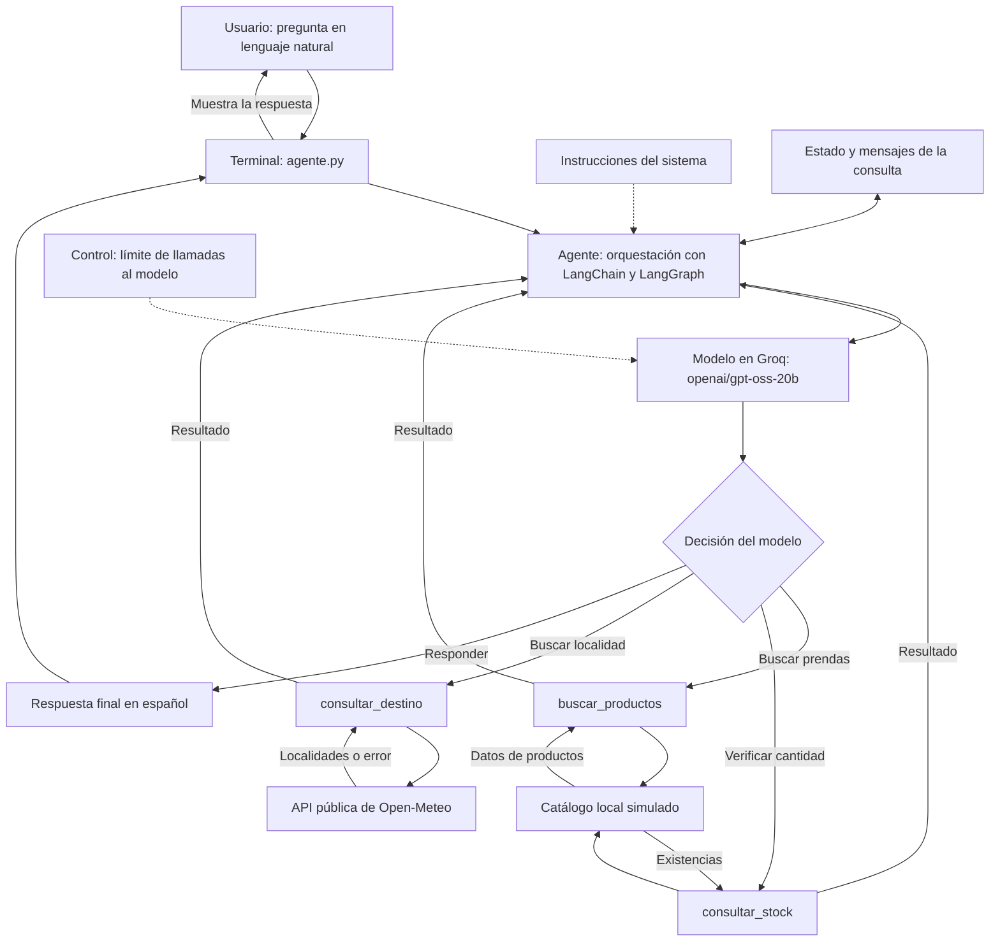

# Agente de ventas e inventario para una tienda de ropa

Proyecto del Módulo 3: Diseño y Orquestación de Agentes Inteligentes.

Asistente en español que consulta un catálogo simulado de ropa, verifica disponibilidad y busca localidades bolivianas. Utiliza LangChain con el modelo `openai/gpt-oss-20b`, servido por Groq.

## 1. Problema y usuario

En una tienda de ropa, atender una pregunta como «¿Tienen dos vestidos rojos talla M?» exige identificar la prenda y comprobar si las existencias alcanzan. Buscar estos datos manualmente durante cada conversación puede demorar la atención y provocar errores.

El usuario principal es el vendedor o encargado de una pequeña tienda, que necesita consultar productos, precios y cantidades mediante preguntas cotidianas. El agente también permite buscar una localidad cuando surge una consulta sobre una ciudad boliviana.

El prototipo trabaja con **15 prendas simuladas**, con códigos de `ROP001` a `ROP015` y precios en bolivianos (Bs). No representa un inventario comercial real. Sus herramientas son de lectura: no registra ventas, descuenta existencias, reserva prendas ni procesa pagos. Encontrar una localidad tampoco confirma cobertura de envío.

## 2. Por qué es un agente

Es un **agente con herramientas** porque el modelo interpreta cada pregunta y decide qué herramienta utilizar, con qué argumentos y si necesita otra consulta antes de responder.

Por ejemplo, ante una solicitud de dos vestidos puede buscar primero la prenda, obtener su código y después consultar la disponibilidad para esa cantidad. Ante una pregunta sobre Cochabamba, puede utilizar directamente la herramienta de localidades.

Un workflow establecería de antemano una secuencia fija o ramas programadas para cada situación. Aquí el recorrido depende de las decisiones del modelo y de los resultados que recibe. El patrón es de tipo ReAct: decidir una acción, ejecutar una herramienta, observar su resultado y continuar hasta responder o alcanzar un límite.

## 3. Arquitectura



Las herramientas devuelven sus resultados al agente para que el modelo decida el siguiente paso. El estado se mantiene durante esa consulta; cada nueva ejecución comienza sin el historial anterior. El límite de llamadas puede detener el recorrido antes de completar la respuesta.

## 4. Herramientas y fuentes de información

Las tres herramientas están definidas en [herramientas.py](herramientas.py).

| Herramienta | Entrada | Información que devuelve | Fuente |
|---|---|---|---|
| `buscar_productos` | Nombre, talla y color; filtros opcionales. | Prendas coincidentes con código, precio y stock. | [catalogo.py](catalogo.py). |
| `consultar_stock` | Código del producto y cantidad; por defecto, una unidad. | Existencias y si alcanzan para la cantidad solicitada. | [catalogo.py](catalogo.py). |
| `consultar_destino` | Nombre de una ciudad. | Hasta cinco localidades bolivianas coincidentes y sus departamentos. | API pública de geocodificación de Open-Meteo. |

La búsqueda de productos normaliza mayúsculas, tildes y algunas variantes de plurales y colores; no comprende todos los sinónimos. La consulta de stock no modifica el catálogo.

`consultar_destino` realiza una petición HTTP real a `https://geocoding-api.open-meteo.com/v1/search`, restringida a Bolivia y con un tiempo de espera de diez segundos. Maneja errores de conexión, tiempo de espera, estado HTTP y respuestas JSON inválidas. La clave de Groq no se envía a esta API.

Los errores de las funciones se devuelven en el campo `mensaje` con un texto que empieza por `ERROR:`, por ejemplo:

```text
ERROR: Producto inexistente
ERROR: La cantidad debe ser un entero positivo
ERROR: No se pudo conectar con Open-Meteo
```

Los errores de validación del decorador también pueden devolver directamente un texto con ese prefijo. Una búsqueda sin coincidencias o un producto agotado son resultados normales, no errores técnicos.

## 5. Los cinco primitivos

### 5.1. Instrucciones

El texto `instrucciones` de [agente.py](agente.py) define el rol de asistente de ventas de ropa en Bolivia. Indica que debe responder brevemente en español, consultar las herramientas antes de afirmar datos, expresar precios en Bs y explicar los errores sin inventar resultados.

También delimita las operaciones permitidas: consultar el catálogo, la disponibilidad y las localidades. Si falta información indispensable, debe pedir aclaraciones. Estas instrucciones orientan al modelo, pero no garantizan que siempre las cumpla.

### 5.2. Herramientas

Son las funciones que conectan las decisiones del modelo con datos consultables. `buscar_productos` y `consultar_stock` acceden al catálogo local; `consultar_destino` accede a una API pública real. El agente selecciona entre ellas según la pregunta y los resultados anteriores.

### 5.3. Memoria

La memoria es **temporal y limitada a una invocación**: el historial de mensajes permite que el modelo utilice los resultados de una herramienta al decidir su siguiente acción.

No hay memoria persistente, base de conversaciones ni checkpointer configurado. Al ejecutar de nuevo `python agente.py`, el agente no recuerda las consultas anteriores. Una aclaración posterior necesitaría una aplicación que conservara y reenviara el historial.

### 5.4. Estado

El estado representa la situación actual de la ejecución. Incluye la pregunta del usuario, los mensajes del modelo, las llamadas propuestas a herramientas y sus resultados.

En el flujo se intercambian mensajes del usuario, `AIMessage` con decisiones o respuestas, y `ToolMessage` con resultados asociados a sus llamadas. El middleware también mantiene contadores de llamadas. Este estado permite continuar el proceso; no modifica las existencias del catálogo.

La memoria se refiere al contexto que el agente conserva durante la consulta; el estado es la estructura que contiene ese contexto y la información de ejecución en cada paso.

### 5.5. Control

Se utiliza `ModelCallLimitMiddleware` para limitar las llamadas al modelo:

```python
ModelCallLimitMiddleware(
    run_limit=int(os.getenv("MODEL_RUN_LIMIT", "5")),
    exit_behavior="end"
)
```

El límite predeterminado es de **cinco llamadas al modelo por consulta**. Si intenta superarlo, el middleware termina la ejecución con un mensaje de límite alcanzado. Además, `recursion_limit=15` limita los pasos del flujo; no equivale al número de llamadas al modelo. Los reintentos del cliente de Groq se configuran por separado.

No se utiliza aprobación humana porque las herramientas actuales solo leen datos. Tendría sentido incorporarla antes de acciones con consecuencias, como registrar una venta, descontar inventario o procesar un pago. La demostración del control elegido se explica en la sección 7.

## 6. Instalación y uso en Windows

Requisitos: Python 3.12, PowerShell, conexión a internet y una clave válida de Groq.

Desde la carpeta del proyecto:

```powershell
py -3.12 -m venv .venv
.\.venv\Scripts\python.exe -m pip install -r requirements.txt
```

En una instalación nueva, copia `.env.example` a `.env` y configura `GROQ_API_KEY`. Si `.env` ya existe, conserva su contenido. Este archivo está excluido mediante `.gitignore`: no debe subirse al repositorio ni mostrarse durante una presentación.

Con el entorno virtual activo:

```powershell
python agente.py "¿Tienen blusas negras talla M?"
```

Sin activar el entorno, puedes usar directamente su intérprete:

```powershell
.\.venv\Scripts\python.exe -B -X utf8 agente.py "¿Tienen blusas negras talla M?"
```

La terminal muestra `CONSULTA` y `RESPUESTA`. Si se ejecuta `python agente.py` sin una pregunta, utiliza la consulta predeterminada del vestido rojo talla M para dos unidades. Cada ejecución real utiliza Groq y puede consumir créditos o cuota.

## 7. Control elegido y cómo comprobarlo

Elegimos un **límite de llamadas al modelo** porque el agente decide cuántas consultas necesita antes de responder. Este control evita que continúe indefinidamente y acota el número de llamadas por ejecución; no es un presupuesto exacto de dinero ni de tiempo.

No elegimos aprobación humana porque las herramientas actuales solo consultan información. Pedir permiso para leer el stock añadiría un paso innecesario. La aprobación tendría sentido si el agente pudiera registrar ventas, descontar inventario o procesar pagos.

`ModelCallLimitMiddleware` permite cinco llamadas al modelo por consulta de forma predeterminada. Para comprobar que actúa, ejecuta **la misma pregunta con dos límites diferentes**, desde PowerShell y con el entorno virtual activo.

### 1. Comprobar la detención con límite 1

```powershell
$limiteAnterior = $env:MODEL_RUN_LIMIT
$env:MODEL_RUN_LIMIT = "1"
python agente.py "Busca un vestido rojo talla M y verifica si hay 2 unidades disponibles."
```

La consulta necesita continuar después de la primera llamada. El middleware impide hacerlo y muestra:

```text
RESPUESTA: Model call limits exceeded: run limit (1/1)
```

**Este mensaje demuestra que el control intervino.** No es un fallo inesperado: se alcanzó el límite configurado. Esta detención se observó en la comprobación manual del proyecto.

### 2. Comprobar la respuesta con límite 5

```powershell
$env:MODEL_RUN_LIMIT = "5"
python agente.py "Busca un vestido rojo talla M y verifica si hay 2 unidades disponibles."
```

Con más llamadas disponibles, el agente puede completar la consulta. En la comprobación manual confirmó que había **3 unidades**, suficientes para las **2 solicitadas**. La redacción puede variar.

La comparación permite comprobar el control: **con límite 1 se detiene; con límite 5 completa la respuesta**. Si una nueva ejecución no muestra ese comportamiento, revisa la salida antes de considerar demostrada la prueba.

### 3. Restaurar la configuración anterior

Al terminar, ejecuta en la misma terminal:

```powershell
if ($null -eq $limiteAnterior) {
    Remove-Item Env:MODEL_RUN_LIMIT -ErrorAction SilentlyContinue
} else {
    $env:MODEL_RUN_LIMIT = $limiteAnterior
}
```

## 8. Evaluación de cinco casos

[casos.json](casos.json) contiene las preguntas y sus criterios. [pruebas.py](pruebas.py) las envía al agente real, observa las llamadas y calcula el resultado automáticamente.

| Caso | Consulta | `debe_usar` | `no_debe_usar` |
|---|---|---|---|
| 1 | ¿Tienen blusas negras talla M? | `buscar_productos` | `consultar_destino` |
| 2 | ¿Tienen dos vestidos rojos talla M disponibles? | `buscar_productos`, `consultar_stock` | `consultar_destino` |
| 3 | Busca la ciudad de Cochabamba en Bolivia. | `consultar_destino` | `buscar_productos`, `consultar_stock` |
| 4 | ¿Tienen zapatos deportivos talla M? | `buscar_productos` | `consultar_destino` |
| 5 | Consulta si hay una unidad del producto ROP999. | `consultar_stock` | `consultar_destino` |

Un caso aprueba cuando ejecuta todas las herramientas obligatorias, no solicita ninguna prohibida y produce una respuesta final sin errores inesperados. Las herramientas ausentes de ambas listas son opcionales. La ejecución se comprueba mediante la llamada del modelo y el resultado asociado de la herramienta.

El caso 5 exige `ERROR: Producto inexistente` para `ROP999`, cantidad 1, y una respuesta que explique que el producto no existe. **El error esperado puede aprobar:** lo que se evalúa es su manejo correcto. Un error técnico inesperado o una ejecución incompleta cuentan como fallo.

Para revisar las preguntas sin consumir API:

```powershell
python pruebas.py --ver-casos
```

Para ejecutar los cinco casos:

```powershell
python pruebas.py
```

El programa solicita confirmación antes del consumo de Groq. Cada caso muestra pregunta, respuesta, tabla de herramientas con `debe_usar`, `no_debe_usar` u `opcional`, y resultado. El resumen distingue el tipo de caso, muestra el error realmente recibido y calcula:

```text
Cumplimiento = casos aprobados / 5 × 100
```

Para observar también argumentos y resultados completos de herramientas:

```powershell
python pruebas.py --detalle
```

El porcentaje mide selección de herramientas, finalización técnica y las comprobaciones específicas del error esperado. No valida exhaustivamente todas las respuestas; la comprobación del texto del error es heurística. Por ejemplo, una consulta geográfica puede aprobar por usar la herramienta aunque la respuesta no aclare cuál de varias localidades encontradas interesa.

La evaluación solo muestra resultados en terminal: no crea informes, carpetas ni modifica este README. Para presentarla, conserva una captura o grabación de la ejecución completa. El programa devuelve código 0 si todos los casos aprueban y 1 si hay fallos.

### 8.1. Salida real de la evaluación

Transcripción de la ejecución compartida del **16 de noviembre de 2026, a las 13:07:28 de Bolivia (UTC−4)**. El bloque muestra la salida de terminal de los cinco casos y su resumen, incluido el error esperado. No corresponde a una nueva ejecución.

```text
python pruebas.py
Se ejecutarán cinco consultas reales con Groq y pueden consumir créditos. ¿Continuar? [s/N]: s
EVALUACIÓN REAL
Cada caso inicia una consulta nueva. Se evalúan herramientas y errores esperados; no toda la calidad semántica de las respuestas.

CASO 1 DE 5 · Búsqueda de blusa
─────────────────────────────────────────────────────────────────
Pregunta:
¿Tienen blusas negras talla M?

Respuesta del agente:
Sí, tenemos la **Blusa casual** en color negro, talla M.
Stock disponible: 8 unidades.
Precio: **Bs 50.00**.

Herramienta             Criterio          ¿Se ejecutó?
───────────────────────────────────────────────────────
buscar_productos        debe_usar         Sí
consultar_stock         opcional          Sí
consultar_destino       no_debe_usar      No

Resultado: APROBADO

CASO 2 DE 5 · Disponibilidad de dos vestidos
─────────────────────────────────────────────────────────────────
Pregunta:
¿Tienen dos vestidos rojos talla M disponibles?

Respuesta del agente:
Sí, tenemos el **Vestido corto** rojo talla M disponible. Hay 3 unidades en stock, por lo que podemos atender tu solicitud de 2 piezas.

Herramienta             Criterio          ¿Se ejecutó?
───────────────────────────────────────────────────────
buscar_productos        debe_usar         Sí
consultar_stock         debe_usar         Sí
consultar_destino       no_debe_usar      No

Resultado: APROBADO

CASO 3 DE 5 · Consulta de localidad
─────────────────────────────────────────────────────────────────
Pregunta:
Busca la ciudad de Cochabamba en Bolivia.

Respuesta del agente:
Cochabamba se encuentra en Bolivia. Se detectaron varias coincidencias geográficas en la base de datos de Open‑Meteo.

Herramienta             Criterio          ¿Se ejecutó?
───────────────────────────────────────────────────────
buscar_productos        no_debe_usar      No
consultar_stock         no_debe_usar      No
consultar_destino       debe_usar         Sí

Resultado: APROBADO

CASO 4 DE 5 · Búsqueda sin coincidencias
─────────────────────────────────────────────────────────────────
Pregunta:
¿Tienen zapatos deportivos talla M?

Respuesta del agente:
No encontré zapatos deportivos talla M en nuestro catálogo. ¿Te gustaría buscar otro tipo de calzado o revisar otra talla?

Herramienta             Criterio          ¿Se ejecutó?
───────────────────────────────────────────────────────
buscar_productos        debe_usar         Sí
consultar_stock         opcional          No
consultar_destino       no_debe_usar      No

Resultado: APROBADO

CASO 5 DE 5 · Producto inexistente
─────────────────────────────────────────────────────────────────
Pregunta:
Consulta si hay una unidad del producto ROP999.

Respuesta del agente:
El producto ROP999 no existe en nuestro catálogo. Si buscas otro artículo, avísame.

Herramienta             Criterio          ¿Se ejecutó?
───────────────────────────────────────────────────────
buscar_productos        opcional          No
consultar_stock         debe_usar         Sí
consultar_destino       no_debe_usar      No

Resultado: APROBADO
El agente recibió y explicó el error esperado de producto inexistente.

=== RESUMEN ===
Caso     Tipo de caso                  Resultado
───────────────────────────────────────────────────────
1        Consulta normal               APROBADO
2        Consulta normal               APROBADO
3        Consulta a API pública        APROBADO
4        Búsqueda sin coincidencias    APROBADO
5        Error esperado                APROBADO

CASO DE ERROR EVALUADO: 5
  Pregunta: Consulta si hay una unidad del producto ROP999.
  Error esperado: ERROR: Producto inexistente
  Herramienta: consultar_stock
  Argumentos: {"cantidad": 1, "producto_id": "ROP999"}
  Error recibido: ERROR: Producto inexistente
  Respuesta del agente: El producto ROP999 no existe en nuestro catálogo. Si buscas otro artículo, avísame.
  Manejo del error: CORRECTO según los criterios automáticos.

Aprobados: 5/5 | Fallidos: 0
Cumplimiento: 5 / 5 × 100 = 100.0 %
APROBADO significa que cumplió los criterios; un error esperado bien manejado también aprueba.
```

## 9. Archivos del proyecto

| Archivo | Propósito |
|---|---|
| [agente.py](agente.py) | Modelo, instrucciones, herramientas registradas, límite de llamadas y entrada por terminal. |
| [herramientas.py](herramientas.py) | Tres herramientas y manejo de errores. |
| [catalogo.py](catalogo.py) | Catálogo simulado de ropa con precios y existencias. |
| [casos.json](casos.json) | Cinco preguntas con sus criterios de evaluación. |
| [pruebas.py](pruebas.py) | Ejecución real de los casos, comparación y porcentaje en terminal. |
| [requirements.txt](requirements.txt) | Dependencias del proyecto. |
| [.env.example](.env.example) | Plantilla de configuración sin credenciales reales. |
| [.gitignore](.gitignore) | Exclusión de credenciales, entorno virtual y caché. |
